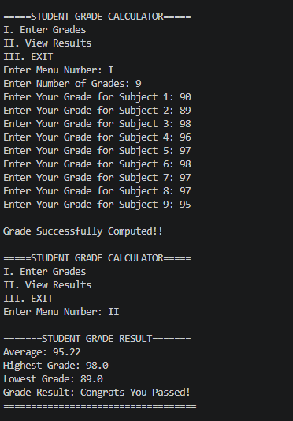
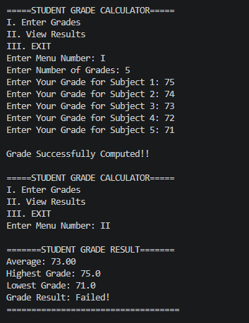
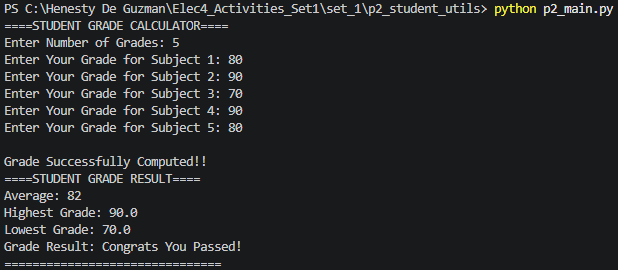
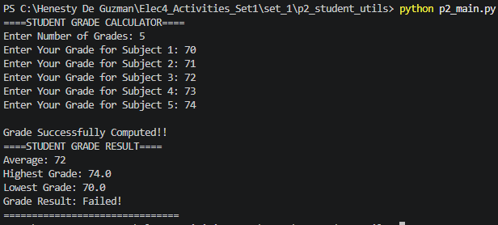
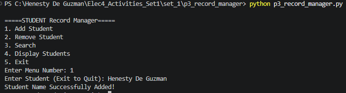
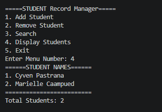
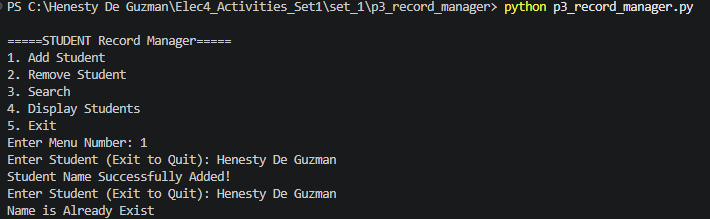
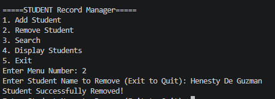
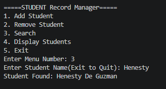

# ELEC 4 - Python Programming

## Student Information

- Name: Henesty G. De Guzman
- Section: IV-BSIT A
- Course: ELEC 4 - Python Programming

## About

This repository contains my Set 1 activities for the self-paced learning assignment in Python Programming. Through these activities, I practiced using functions, modules, lists, sets, and exception handling.

## Set 1 Activities

| Activity | Description |
| --- | --- |
| [P1 - Student Grade Calculator](set1/p1/) | Calculates student grades using functions. |
| [P2 - Custom Module](set1/p2/) | Uses a separate module for grade calculations. |
| [P3 - Student Record Manager](set1/p3/) | Manages student names using lists and sets. |
| [P4 - Safe Menu Program](set1/p4/) | Handles errors using exception handling. |

## How to Run

Make sure Python 3 is installed. Open CMD or the terminal inside the repository folder. Run each activity using the commands below.

## P1 - Student Grade Calculator

I created a menu-driven program that calculates the average, highest grade, lowest grade, and pass or fail status of a student using functions.

```cmd
python set1/p1/p1_grade_calculator.py
```

### Program Output

Passed Result



Failed Result



## P2 - Custom Module

I separated the grade calculation functions into a module called student_utils.py and imported them into my main program so I could reuse the functions.

```cmd
python set1/p2/p2_main.py
```

### Program Output

Passed Result



Failed Result



## P3 - Student Record Manager

I created a program that allows users to add, remove, search, and display student names. I used a list and a set to manage the names and prevent duplicate entries.

```cmd
python set1/p3/p3_record_manager.py
```

### Program Output

Add Student



Display Students



Duplicate Prevention



Remove Student



Search Student



## P4 - Safe Menu Program

I used exception handling to handle invalid input, division by zero, and missing files without crashing the program.

```cmd
cd set1\p4
python p4_exceptions.py
```

Use test.txt to test the file opening option. After exiting the program, return to the repository folder using:

```cmd
cd ..\..
```

### Program Output

Division by Zero


Invalid Menu Choice


Invalid Number


Missing File


## Reference

- [Bro Code - Python Full Course](https://www.youtube.com/watch?v=ix9cRaBkVe0)
